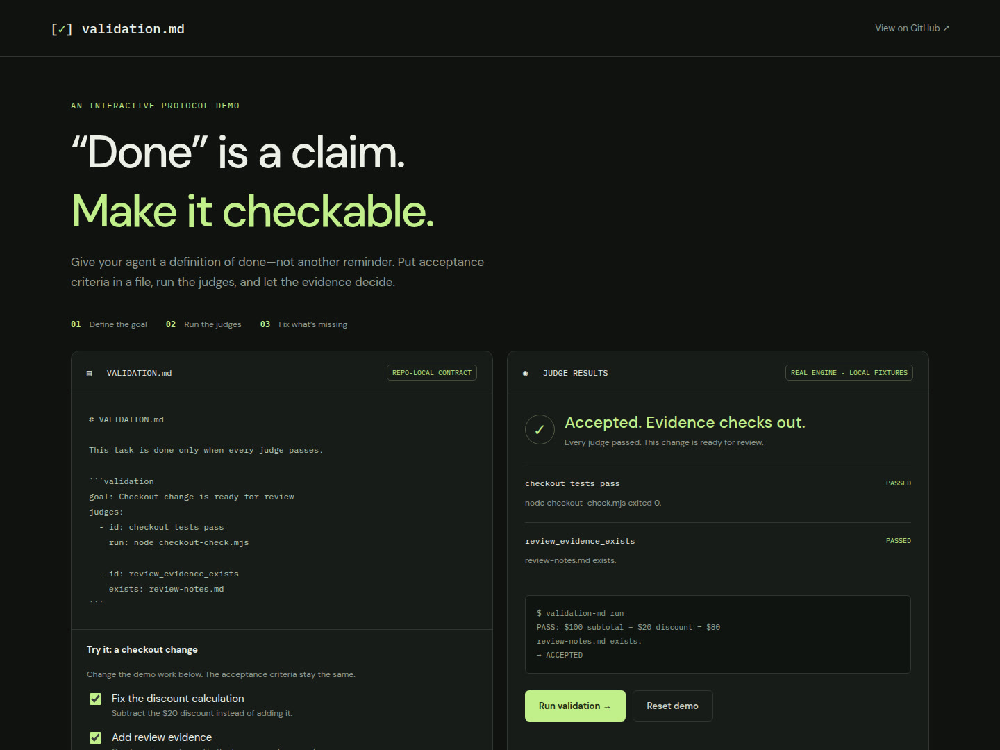

# Interactive validation-md demo

A real browser walkthrough of the **fail → fix → pass** loop. The page calls
`executeValidation` from the repository's engine; results are not simulated.

## Watch the walkthrough

[](assets/validation-md-walkthrough.mp4)

**[Watch or download the walkthrough (MP4)](assets/validation-md-walkthrough.mp4)**

The recording is silent. Follow the steps below as the controls change:

1. **Run validation** with both checkboxes off. The discount calculation is wrong
   and the review artifact is missing, so both judges fail.
2. Select **Fix the discount calculation** and run again. The command judge
   passes, but the missing evidence still blocks completion.
3. Select **Add review evidence** and run again. Both judges pass and the work is
   accepted.

The acceptance criteria remain unchanged throughout. Fix the work, not the gate.

## Run locally

Requires Node.js 18+ and npm. From the repository root:

```sh
npm ci
npm run demo
```

Open <http://localhost:3000>. Set `PORT` to use another port:

```sh
PORT=3001 npm run demo
```

Click **Reset demo** to clear the checkboxes, results, and run counter.

## What this proves (and what it doesn't)

- Each run creates and removes a separate temporary directory containing a fixed
  `VALIDATION.md`, a real Node assertion, and an optional review-notes file.
- The browser sends only two boolean fixture settings. It cannot supply shell
  commands, file paths, or custom validation definitions.
- The file-existence judge checks presence, not the quality of the review.
- No model, API key, or agent is involved. Claude Code stop-hook enforcement is
  not enabled or demonstrated.
- This is a small local demo, not a production multi-user service. Google Fonts
  is optional; system fonts are used when it is unavailable.

The MP4 is a screen recording of this demo, not an animation or mocked result.
